# Examples

Live Gmail results for InboxGuardian V1.1, with the synthetic test emails that produced them. Screenshots show the InboxGuardian side panel in Gmail on the desktop web client.

A screenshot records what one version of the tool did with one message. It is not evidence of detection accuracy, and no result here means a message is safe.

## How to read these examples

Each scenario keeps three kinds of result apart:

- **Expected:** what the current code should produce for the described message.
- **Automated (synthetic):** confirmed by a unit test on fabricated input. This is not a Gmail observation.
- **Observed in Gmail:** what the tester actually saw in Gmail.

All **V1.1 observations** below were made on 2026-10-14 after the V1.1 deployment. Before the add-on was updated, a backend smoke test returned analysis version `engine-0.3.0+scoring-0.3.0`. Observations labelled *earlier* come from older versions and do not confirm V1.1.

Scores come from Method C v1 (see [`docs/scoring-policy.md`](../docs/scoring-policy.md)). The risk index is a heuristic, not a probability of phishing. All test emails were synthetic and sent from a test account to itself.

## Scenarios

| # | Scenario | Live test | V1.1 observed |
|---|---|---|---|
| 1 | Benign email | G01 | 0/100, no significant signals |
| 2 | Suspicious sender identity | — | Not captured |
| 3 | Deceptive link | — | Not captured |
| 4 | Credential phishing | G06 | 20/100, Suspicious |
| 5 | Several signals at once | — | Not captured on V1.1 |
| 6 | Assessment incomplete | — | Not captured on V1.1 |
| 7 | Backend unavailable | G01 | Error state; see [Application states](#application-states-and-error-handling) |
| 8 | Attachments listed and name-only assessed | — | Not captured on V1.1 |
| 9 | Executable attachment | — | Not possible in Gmail (blocked) |
| 10 | Payment redirection (BEC) | G07 | 30/100, Suspicious |
| 11 | Maximum-risk demonstration | MAX | 65/100, High risk |
| 12 | Weak attachment indicator (HTML file) | G04 | 10/100, weak indicator |
| 13 | Benign financial control | G09 | 0/100, no significant signals |
| 14 | VirusTotal consent workflow | G10 | 0/100; enrichment not performed |
| 15 | Gift-card fraud split across sentences | G11 | 0/100 (known false negative) |
| 16 | Multi-vector message | G13 | 55/100, Suspicious |
| 17 | Deployment and coverage check | V01 | 0/100, no significant signals |

---

### 1. Benign email (G01)

- **Test email:** "[IG-FINAL] G01 — Benign email". A short routine note with no attachments, links, credential requests or financial instructions.
- **Expected:** `NO_SIGNIFICANT_SIGNALS`, 0/100, no findings.
- **Observed in Gmail (V1.1):** "No significant suspicious signals found", 0/100, no findings.
- **Explanation:** this is the baseline. The card stays neutral and never says "safe"; it states that the result does not guarantee the message is legitimate.
- *Earlier:* 0/100 on the 2026-10-13 dashboard.

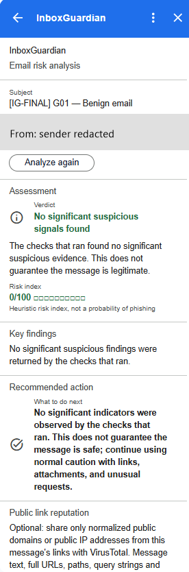

### 2. Suspicious sender identity

- **Test email:** a display name that names a different domain from the real sending address, for example `accounts.example.test` on a message from another domain. This needs an account whose display name you can set.
- **Expected:** `SUSPICIOUS`, 20/100, finding "Display name claims a different domain".
- **Observed in Gmail:** not yet observed. A message sent to yourself carries your own name, so this is covered by automated tests only.

**INSERT SCREENSHOT HERE**

### 3. Deceptive link

- **Test email:** an HTML link whose visible text shows `https://accounts.example.test` while the real destination is `https://accounts.example.test.attacker.test/login`.
- **Expected:** `SUSPICIOUS`, 35/100, finding "Destination host embeds the displayed host as a prefix".
- **Observed in Gmail:** not yet observed on its own; see scenario 5.

**INSERT SCREENSHOT HERE**

### 4. Credential phishing (G06)

- **Test email:** "[IG-FINAL] G06 — Account verification required". It asks the reader to visit a `.test` login link and enter their account password and one-time verification code to prevent suspension.
- **Expected:** `SUSPICIOUS`, with a credential finding.
- **Observed in Gmail (V1.1):** "Suspicious — Verification recommended", 20/100. Main finding "Message asks for login secrets" (+20, medium severity). A second finding, "Credential request appears alongside links", is context only (+0).
- **Explanation:** requests for passwords or authentication codes are a core phishing pattern. The finding quotes the matched request and explains why it matters.
- **Limitations:** keyword rules miss paraphrases. *Earlier*, a different credential message scored 25/100 on the 2026-10-13 dashboard; the two messages are not identical.

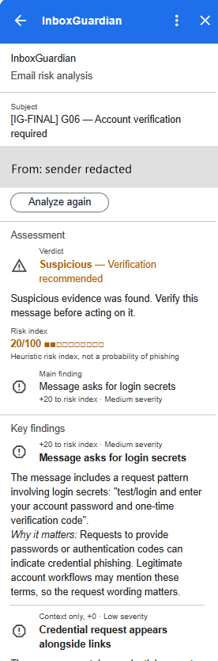

### 5. Several signals at once

- **Test email:** scenarios 3 and 4 combined.
- **Expected:** `HIGH_RISK`, 60/100, with the link finding listed first.
- **Observed in Gmail:** *earlier*, 60/100 `HIGH_RISK` with the URL finding first (2026-10-13 dashboard). Not captured on V1.1.

**INSERT SCREENSHOT HERE**

### 6. Assessment incomplete

- **Test email:** a forwarded message, where the content below the "Forwarded message" marker was written by someone else.
- **Expected:** `INCOMPLETE`, "Risk score unavailable" with no number or bar.
- **Observed in Gmail:** *earlier*, `INCOMPLETE` with no score (2026-10-13). Not captured on V1.1.

**INSERT SCREENSHOT HERE**

### 7. Backend unavailable

- **Setup:** stop the backend, then click **Analyze Email**.
- **Expected:** "Analysis unavailable", with no verdict and no score.
- **Observed in Gmail (V1.1):** "Unable to analyze this email." with no verdict or score. The screenshot and explanation are under [Application states and error handling](#application-states-and-error-handling).
- *Earlier:* "Analysis unavailable" with no verdict or score (2026-10-13).

### 8. Attachments listed and name-only assessed

- **Test email:** a benign message with one small `.txt` attachment.
- **Expected:** the same verdict as without the attachment, plus a coverage line saying only attachment names were checked.
- **Observed in Gmail:** *earlier*, an ordinary PDF scored 0/100 on `engine-0.2.0+scoring-0.2.0`, and a 30-attachment message listed 30 with 25 detailed entries. Not captured on V1.1.

**INSERT SCREENSHOT HERE**

### 9. Executable attachment

- **Test email:** a file named like `invoice.pdf.exe`, created locally and never opened.
- **Expected:** `SUSPICIOUS`, with a finding based on the filename pattern only.
- **Observed in Gmail:** not possible; Gmail blocks executable attachments. This case is covered by automated tests only.

**INSERT SCREENSHOT HERE**

### 10. Payment redirection (G07)

- **Test email:** "[IG-FINAL] G07 — Updated payment details". It says the bank account has changed, asks for the outstanding invoice to be paid to the new account, says the transfer must be done today without calling accounting to verify, and asks for the new instructions to be used immediately.
- **Expected:** a financial-fraud finding on a backend reporting `engine-0.3.0+scoring-0.3.0`.
- **Automated (synthetic):** a single-sentence variant ("Send the invoice payment to our new bank account today and skip the usual callback verification.") scores 25/100, `SUSPICIOUS` (`tests/unit/test_maximum_risk_example.py`).
- **Observed in Gmail (V1.1):** "Suspicious — Verification recommended", 30/100. One finding: "Payment destination change request" (+30, medium severity), quoting the request with the invoice and account references redacted.
- **Explanation:** redirecting a payment to new bank details is a common business email compromise (BEC) pattern. The finding advises verifying through an independently established process.
- **Limitations:** the screenshot shows only the destination-change finding, so the "do not call to verify" instruction did not add points of its own. Each financial rule matches within one sentence, and sentences phrased as "do not / should not …" can be skipped. *Earlier*, this test scored 0/100 because the running backend was the older `engine-0.2.0`, which has no financial-fraud detector.

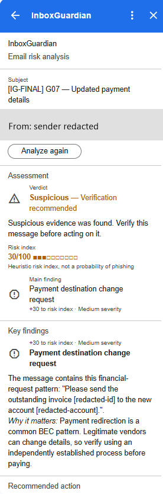

### 11. Maximum-risk demonstration (MAX)

- **Test email:** "[IG-FINAL] MAX — Multi-vector Phishing Demonstration". It contains an account-suspension threat asking for a password and one-time code, a link to a lookalike login hostname under `example.test`, a request to redirect an invoice payment to a new bank account, an urgent gift-card request with secrecy wording, and an `ig-page.html` attachment.
- **Expected for the documented draft:** 100/100, `HIGH_RISK`. See [maximum-risk.md](maximum-risk.md) for the draft and the reasoning.
- **Automated (synthetic):** 100/100, `HIGH_RISK`, for both fixture versions (`tests/unit/test_maximum_risk_example.py`).
- **Observed in Gmail (V1.1):** "High risk — Treat with caution", **65/100**, with six findings. The visible ones are "Gift-card code request" (+30) and "Message asks for login secrets" (+20).
- **Explanation:** several independent kinds of evidence together raise the verdict to High risk. The live score is lower than the fixture's 100. The email that was sent is not the documented draft: it has one link whose visible text is a URL, instead of the draft's two links whose visible text differs from their destination, and its payment and gift-card wording differs. The per-family breakdown was not captured, so the exact reason for the 35-point difference has not been verified.
- **Limitations:** the 100/100 figure is an automated result on fabricated input, not a live observation. This test's link hostname begins with a real brand name; future tests should use only neutral `.test` names.

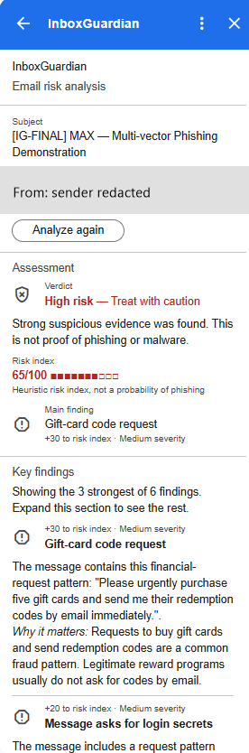

### 12. Weak attachment indicator (G04)

- **Test email:** "[IG-FINAL] G04 — HTML attachment", with a harmless synthetic `ig-page.html` attachment.
- **Expected:** `NO_SIGNIFICANT_SIGNALS` with a positive score and a weak-indicator display note.
- **Observed in Gmail (V1.1):** "No significant suspicious signals found", 10/100, with the display interpretation "Weak indicator detected — Review findings". Main finding: "Attachment type that can contain active content" (+10, weak on its own, low severity).
- **Explanation:** HTML files can imitate sign-in pages, so the name is flagged, but the evidence is too weak to change the verdict. The card states that the backend verdict is unchanged and that the finding is not confirmed malicious.
- **Limitations:** only the filename is checked; attachment content is never opened or scanned.

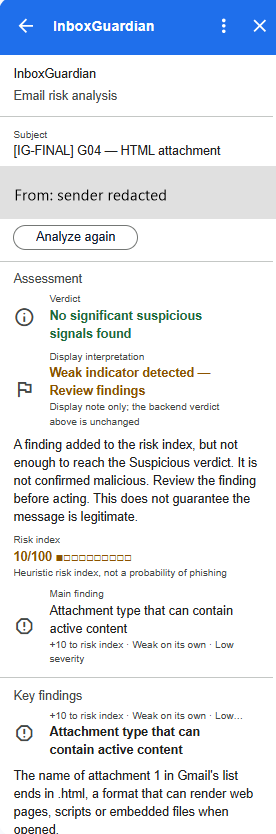

### 13. Benign financial control (G09)

- **Test email:** "[IG-FINAL] G09 — Routine invoice reminder". It says invoice `INV-DEMO-001` is due next week, to use the previously agreed payment method, that bank details have not changed, and that there is no urgency.
- **Expected:** `NO_SIGNIFICANT_SIGNALS`, 0/100.
- **Observed in Gmail (V1.1):** "No significant suspicious signals found", 0/100, no findings.
- **Explanation:** ordinary finance wording without a destination change, urgency, bypass or secrecy does not trigger the financial-fraud rules. This is the false-positive control for scenario 10.

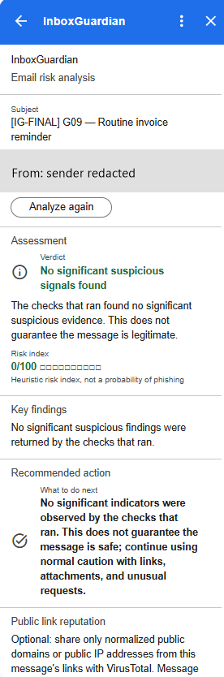

### 14. VirusTotal consent workflow (G10)

- **Test email:** "[IG-FINAL] G10 — Public website reputation check", with one link to a public website and no requests.
- **Expected:** a normal deterministic result, plus a separate optional action to check public link reputation.
- **Observed in Gmail (V1.1):** "No significant suspicious signals found", 0/100, no findings. The **Public link reputation** section offers the optional check and states what would be shared.
- **Explanation:** **Analyze Email** never contacts VirusTotal. Sharing requires a separate action, and only normalized public domains or IP addresses would be sent.
- **Limitations:** VirusTotal enrichment is disabled on the backend, so no external reputation lookup was performed and no reputation result is shown.

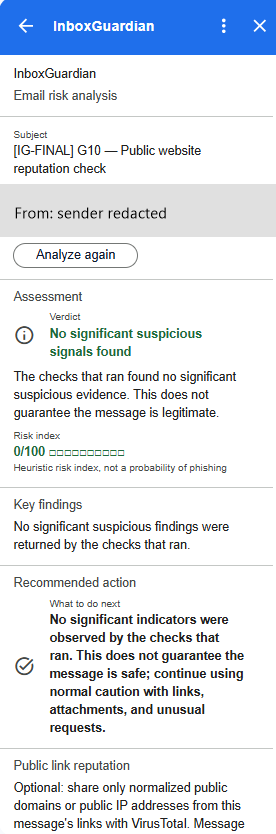

### 15. Gift-card fraud split across sentences (G11)

- **Test email:** "[IG-FINAL] G11 — Urgent gift-card purchase". It asks for five gift cards to be bought immediately for a confidential request, then (in a separate sentence) for the redemption codes to be emailed, then for the request to be kept private without calling to confirm.
- **Expected for V1.1:** no financial finding, because of a documented limitation.
- **Automated (synthetic):** a one-sentence version ("Buy five gift cards today and email me the redemption codes; keep this confidential.") produces a gift-card finding.
- **Observed in Gmail (V1.1):** "No significant suspicious signals found", 0/100, no findings.
- **Explanation:** this is a **known false negative**. Each financial rule only matches when its indicators share one sentence: here "gift cards" and "redemption codes" are in different sentences. The secrecy wording ("keep this private and do not call to confirm") is recognized, but the secrecy rule also requires payment wording, and gift cards are not counted as payment wording.
- **Limitations:** detector logic is frozen for V1.1. Do not rely on InboxGuardian alone for financial requests.

### 16. Multi-vector message (G13)

- **Test email:** "[IG-FINAL] G13 — Critical security and payment verification". It contains an account-suspension threat, a `.test` link asking for a password and one-time code, a request to redirect an invoice payment to a new bank account, an urgent gift-card request, a secrecy sentence, and an `ig-page.txt` attachment.
- **Observed in Gmail (V1.1):** "Suspicious — Verification recommended", **55/100**, with five findings. The visible ones are "Gift-card code request" (+30, main finding) and "Message asks for login secrets" (+20).
- **Explanation:** financial and credential evidence combine to a higher score, while the verdict remains Suspicious rather than High risk.
- *Earlier:* 25/100, before the V1.1 deployment. G13 is a separate test, not the maximum-risk fixture.

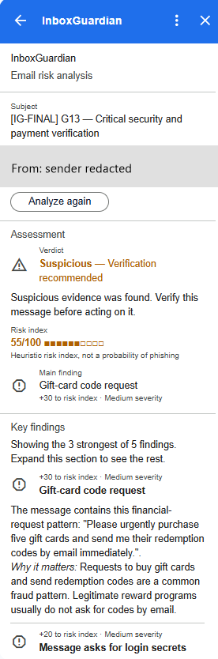

### 17. Deployment and coverage check (V01)

- **Test email:** "[IG-FINAL] V01 — Backend Version and Coverage Verification". A routine message with no links, attachments, credential requests or financial instructions.
- **Expected:** 0/100, with Additional details showing `engine-0.3.0+scoring-0.3.0`.
- **Observed in Gmail (V1.1):** "No significant suspicious signals found", 0/100, no findings.
- **Explanation:** this confirms the deployed add-on reaches the backend and renders a result. The analysis version itself is not visible in this screenshot; it was confirmed by the backend smoke test at deployment.

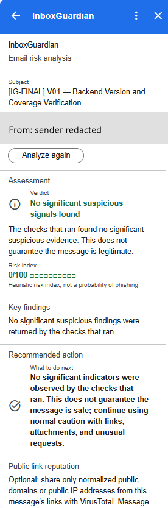

## Application states and error handling

These are not threat-detection scenarios and carry no risk assessment. They show how the add-on behaves when there is no message to analyze, or when the analysis cannot be completed.

### No specific email selected

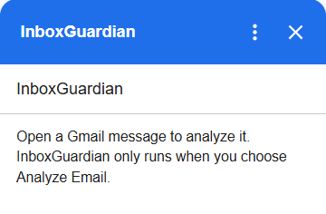

When InboxGuardian is opened from the inbox list without opening a message, the panel shows only: "Open a Gmail message to analyze it. InboxGuardian only runs when you choose Analyze Email." No verdict, score or analysis button is shown.

Analysis needs the context of one opened message, because the add-on reads only the message the user has open. This is normal behavior, not a failed or empty security assessment. Open a message to see the **Analyze Email** action.

### Backend unavailable

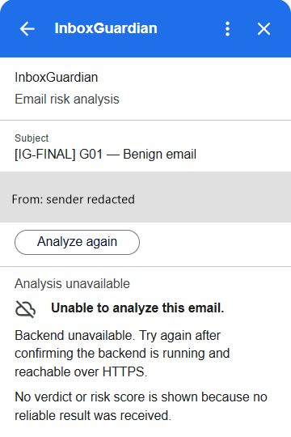

This was captured after the FastAPI/Uvicorn backend was stopped with Ctrl+C, then the G01 benign test email was analyzed again. The panel shows "Analysis unavailable" and "Unable to analyze this email." It goes on: "Backend unavailable. Try again after confirming the backend is running and reachable over HTTPS." and "No verdict or risk score is shown because no reliable result was received."

This is an availability error, not a risk assessment. With the backend running, the same email scored 0/100 (scenario 1). Here the add-on deliberately shows no score at all, so a failed analysis is never mistaken for a low-risk or safe result. Restart the backend, then choose **Analyze again**.

## Live Gmail observation log

| Test | Earlier observation | V1.1 observation | Scenario |
|---|---|---|---|
| G01 | 0/100 | 0/100 | 1 |
| G04 | 10/100 (`engine-0.2.0`) | 10/100, weak indicator | 12 |
| G06 | — | 20/100, Suspicious | 4 |
| G07 | 0/100 (`engine-0.2.0`, no financial detector) | 30/100, Suspicious | 10 |
| G09 | — | 0/100 | 13 |
| G10 | — | 0/100, consent section shown | 14 |
| G11 | 0/100 (`engine-0.2.0`) | 0/100 (known false negative) | 15 |
| G13 | 25/100 | 55/100, Suspicious | 16 |
| MAX | — | 65/100, High risk | 11 |
| V01 | — | 0/100 | 17 |

## Capturing more screenshots

- Use **synthetic messages only**, sent from your own test account to itself. Never capture real mail.
- Use reserved example domains such as `example.test` in addresses and links. Do not use real brands, people or companies.
- Before saving, crop to the InboxGuardian panel and redact private details: your name and address (including the **From** field inside the panel), account picture, browser address bar, bookmarks, other messages, tunnel URLs and Script Properties.
- Save images as PNG in [`screenshots/`](screenshots/).
